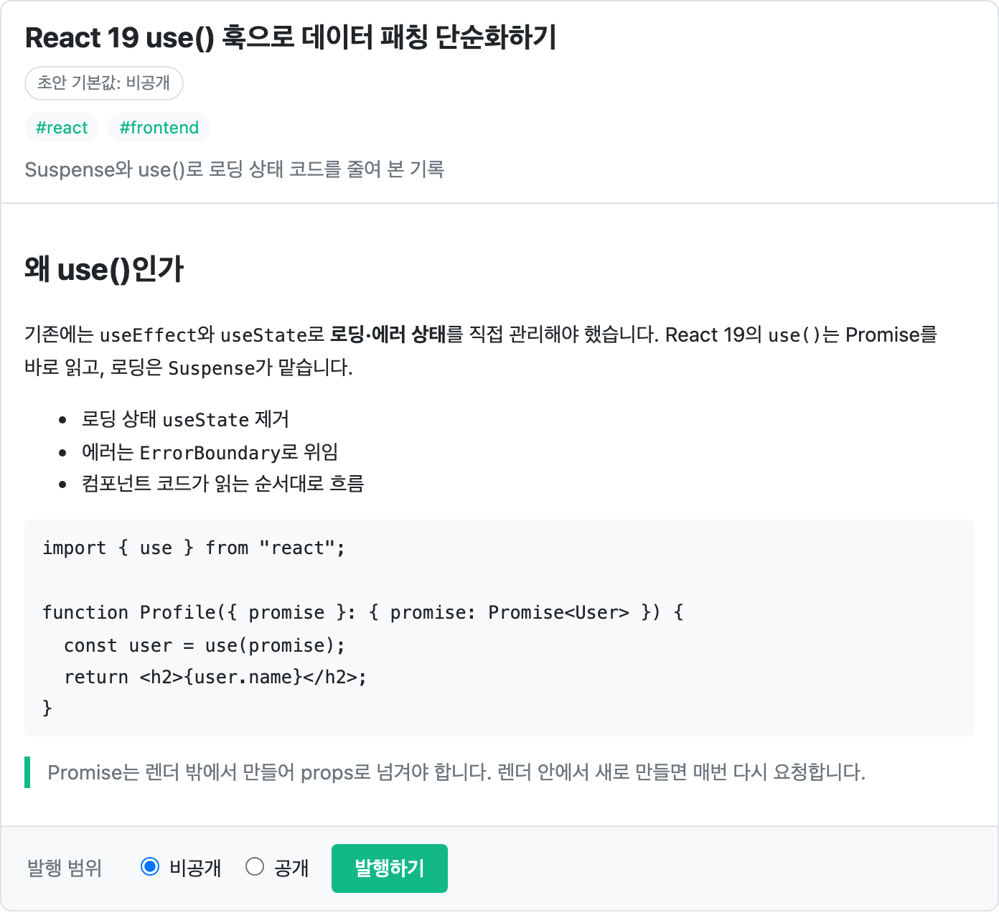
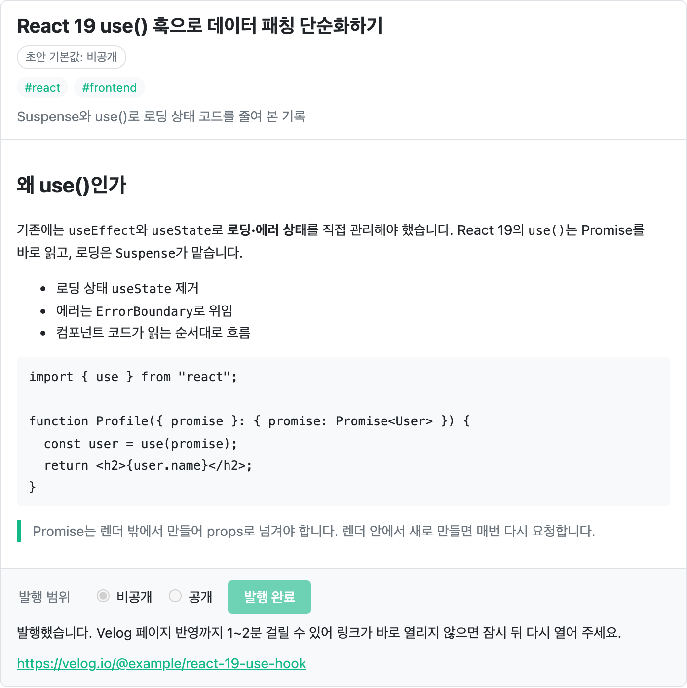

# velog-mcp-claude

[](https://www.npmjs.com/package/velog-mcp-claude)
[](https://www.npmjs.com/package/velog-mcp-claude)
[](https://github.com/seongwon030/velog_mcp/actions/workflows/ci.yml)
[](./LICENSE)

> Velog 개발자([@velopert](https://github.com/velopert))로부터 운영을 허용한다는 답변을 받은 독립 오픈소스입니다.

**Claude에게 말로 부탁하면 Velog 글을 쓰고, 발행하고, 관리해 주는 MCP 서버입니다.**

할 수 있는 것:

- **글쓰기와 발행**: 주제나 git 커밋을 주면 초안을 먼저 보여 주고, 원할 때 공개 또는 비공개로 발행합니다.
- **주제 찾기**: 트렌딩 글을 주제별로 정리하고, 내가 아직 안 쓴 인기 주제를 추천합니다.
- **블로그 관리**: 기존 글 수정·삭제, 시리즈 관리, 이미지 업로드, 태그·임시저장 글 조회를 합니다.
- **소통**: 댓글 조회·작성·수정·삭제, 좋아요, 검색, 읽을 목록과 알림 수를 확인합니다.

stdio 기반 표준 MCP 서버라 Claude Code, Claude Desktop, Codex CLI처럼 MCP를 지원하는 클라이언트에서 모두 동작합니다.

**npm**: [velog-mcp-claude](https://www.npmjs.com/package/velog-mcp-claude) | **요구사항**: Node.js 18+

## 빠른 시작

### 1. Velog 토큰 저장

```bash
npx -p velog-mcp-claude velog-mcp-setup
```

Velog에 로그인한 브라우저에서 DevTools → Application → Cookies → `https://velog.io`를 열고, `access_token`과 `refresh_token` 값을 복사해 입력하세요.

토큰은 `~/.velog-mcp.json`에 `0600` 권한(본인만 읽기·쓰기)으로 저장됩니다.

### 2. 클라이언트에 등록

Claude Code라면 한 줄이면 됩니다.

```bash
claude mcp add velog -- npx -y velog-mcp-claude
```

Claude Desktop과 Codex CLI는 [클라이언트별 설정](#클라이언트별-설정)을 보세요. 등록한 뒤에는 클라이언트를 다시 시작하세요.

### 3. 말 걸어 보기

```text
이번 주 벨로그 트렌딩 글을 주제별로 정리해줘
```

트렌딩 브리핑이 나오면 연결된 것입니다. 다음 절의 예시를 이어서 시도해 보세요.

## 이렇게 말해 보세요

| 이렇게 말하면 | 이렇게 동작합니다 |
| --- | --- |
| "이번 주 벨로그 트렌딩 주제별로 정리해줘" | `velog_trend_report`로 트렌딩 글을 가져와 주제별로 묶어 브리핑합니다. |
| "내가 아직 안 쓴 인기 주제 3개 추천해줘" | `velog_topic_research`가 트렌딩 태그와 내 글의 태그를 비교해, 아직 안 다룬 주제를 찾습니다. |
| "오늘 작업한 커밋들로 벨로그 글 써줘" | `velog_git_to_post`로 최근 커밋과 diff를 읽고, 그 내용으로 초안을 만듭니다. |
| "React 상태 관리로 글 초안 써줘" | `velog_draft_post`로 초안을 만듭니다. `write_post` 프롬프트를 쓰면 먼저 `velog_search_posts`로 비슷한 글을 찾아봅니다. 지원 클라이언트에서는 [미리보기 카드](#초안-미리보기-카드-mcp-apps)가 뜨고, 카드에서 바로 발행할 수 있습니다. |
| "최근 글 3개를 '삽질 기록' 시리즈로 묶어줘" | `velog_list_posts`로 글을 찾고 `velog_create_series`로 시리즈를 만든 뒤 `velog_append_to_series`로 글을 넣습니다. |
| "내 최근 글에 달린 댓글 보여주고 답글 달아줘" | `velog_get_comments`로 댓글과 대댓글을 읽고, `velog_write_comment`로 대댓글을 씁니다. |
| "깃허브 블로그 `_posts` 글들을 벨로그 초안으로 옮겨줘" | `velog_import_from_github`가 저장소의 마크다운을 읽어 초안으로 만듭니다. `dry_run: true`로 먼저 미리보기를 확인하세요. |

자주 쓰는 흐름은 [프롬프트(슬래시 커맨드)](#프롬프트-슬래시-커맨드)로도 제공합니다.

> [!WARNING]
> **공개 발행과 삭제는 되돌리기 어렵습니다.** 공개 발행한 글은 RSS·검색으로 퍼져 나중에 비공개로 돌려도 완전히 회수되지 않고, 삭제한 글과 댓글은 복구되지 않습니다. 이 서버의 프롬프트는 공개·비공개를 고르기 전까지 발행하지 않도록 Claude에게 지시하고, 발행·삭제·수정 툴에는 클라이언트가 경고를 띄울 수 있도록 annotations를 붙였습니다. 그래도 Claude가 발행이나 삭제를 하려 하면 내용을 직접 확인한 뒤 승인하세요. 자세한 내용은 [docs/security.md](./docs/security.md)를 참고하세요.

## 초안 미리보기 카드 (MCP Apps)

[MCP Apps](https://github.com/modelcontextprotocol/ext-apps)를 지원하는 클라이언트에서는 `velog_draft_post`를 호출하면 대화 안에 초안 카드가 뜹니다.

<p align="center">
  <picture>
    <source media="(prefers-color-scheme: dark)" srcset="docs/images/draft-preview-dark.png">
    
  </picture>
</p>

- 제목, 태그, 시리즈, 공개 여부, 요약, 썸네일, 마크다운 본문을 렌더링해서 보여줍니다.
- 카드에서 비공개/공개를 고르고 **발행하기**를 누르면 바로 발행됩니다. 기본 선택은 초안에 지정된 공개 여부입니다.
- 공개 발행은 버튼을 두 번 눌러야 진행됩니다. 첫 클릭에서 버튼이 "정말 공개로 발행할까요? 한 번 더 누르세요"로 바뀝니다.
- 발행이 끝나면 포스트 URL이 표시되고, 누르면 브라우저에서 열립니다. Velog 페이지에 반영되기까지 1~2분 걸릴 수 있으니, 링크가 바로 열리지 않으면 잠시 뒤 다시 열어 보세요.

<p align="center">
  
</p>

### 카드가 보이는 클라이언트

| 클라이언트 | 카드 표시 |
| --- | --- |
| Claude Desktop 등 로컬 MCP 서버를 연결할 수 있고 MCP Apps를 지원하는 클라이언트 | 카드가 보입니다. |
| Claude Code, Codex CLI | 카드 없이 지금처럼 텍스트 결과만 보여줍니다. 동작은 같습니다. |
| claude.ai 웹·모바일 | 원격 커넥터만 연결할 수 있어 이 로컬(stdio) 서버를 직접 붙일 수 없습니다. |

어떤 클라이언트에서 카드가 보이는지는 클라이언트의 MCP Apps 지원 여부에 달려 있습니다.

카드는 본문 전체를 불러오기 위해 앱 전용 툴 `velog_get_draft`를 씁니다. MCP Apps를 지원하는 클라이언트는 이 툴을 모델에게 보여주지 않습니다.

### 지금 카드를 써 보려면 (로컬 빌드)

카드는 npm에 배포된 최신 버전(0.23.0) 이후에 추가되어, 다음 npm 릴리스 전까지는 이 저장소를 직접 빌드해야 합니다. 빌드에는 Node.js 20 이상이 필요합니다.

```bash
git clone https://github.com/seongwon030/velog_mcp.git
cd velog_mcp
npm install
npm run build
```

그다음 Claude Desktop 설정에서 `npx` 대신 빌드 결과물을 가리키세요. 경로는 절대 경로로 적습니다.

```json
{
  "mcpServers": {
    "velog": {
      "command": "node",
      "args": ["/절대/경로/velog_mcp/dist/index.js"]
    }
  }
}
```

nvm 등으로 Node를 설치했다면 Claude Desktop이 `node`를 찾지 못할 수 있습니다. 이때는 터미널에서 `which node`로 확인한 절대 경로를 `command`에 적으세요.

토큰은 빠른 시작 1단계에서 저장한 `~/.velog-mcp.json`을 그대로 씁니다.

## 클라이언트별 설정

### Claude Code

```bash
claude mcp add velog -- npx -y velog-mcp-claude
```

모든 프로젝트에서 쓰려면 사용자 범위로 추가하세요.

```bash
claude mcp add --scope user velog -- npx -y velog-mcp-claude
```

### Claude Desktop

`~/Library/Application Support/Claude/claude_desktop_config.json`에 추가합니다.

```json
{
  "mcpServers": {
    "velog": {
      "command": "npx",
      "args": ["-y", "velog-mcp-claude"]
    }
  }
}
```

### Codex CLI

```bash
codex mcp add velog -- npx -y velog-mcp-claude
```

또는 `~/.codex/config.toml`에 직접 추가합니다.

```toml
[mcp_servers.velog]
command = "npx"
args = ["-y", "velog-mcp-claude"]
```

등록 확인은 `codex mcp list`로 합니다.

## 프롬프트 (슬래시 커맨드)

자주 쓰는 작업을 MCP 프롬프트로 제공합니다. Claude Code에서는 `/mcp__velog__write_post`처럼 슬래시 커맨드로, Claude Desktop에서는 프롬프트 메뉴에서 고를 수 있습니다.

| 프롬프트 | 인자 | 설명 |
| --- | --- | --- |
| `write_post` | `topic`(필수), `tags` | 비슷한 글을 찾아본 뒤 초안 작성 |
| `trend_brief` | `timeframe` | 트렌딩 포스트를 주제별로 묶어 브리핑 |
| `topic_ideas` | `focus_tags` | 아직 안 쓴 인기 주제 3개 제안 |
| `commits_to_post` | `repo_path`, `since` | 최근 커밋과 diff로 기술 블로그 초안 작성 |

초안을 만드는 프롬프트는 사용자가 공개/비공개를 고르기 전까지 발행하지 않도록 지시합니다.

## 툴 목록

모든 툴에는 MCP annotations(`readOnlyHint`, `destructiveHint` 등)가 붙어 있습니다. 클라이언트는 이를 보고 조회 툴은 바로 실행하고, 삭제·수정 툴에는 경고를 띄울 수 있습니다.

<details>
<summary><strong>포스트</strong> (9개)</summary>

| 툴 | 설명 |
| --- | --- |
| `velog_draft_post` | 포스트 초안 생성 |
| `velog_publish_post` | 초안을 Velog에 발행 |
| `velog_list_posts` | 내 포스트 목록 조회 |
| `velog_get_post` | 특정 포스트 전체 내용 조회 (조회수 포함) |
| `velog_update_post` | 기존 포스트 수정 |
| `velog_delete_post` | 포스트 삭제 |
| `velog_upload_image` | 로컬 이미지를 Velog CDN에 업로드 |
| `velog_import_from_github` | GitHub 블로그 마크다운을 Velog 초안으로 가져오기 |
| `velog_git_to_post` | git 커밋 이력과 diff를 분석해 블로그 초안 프롬프트 생성 |

</details>

<details>
<summary><strong>시리즈</strong> (5개)</summary>

| 툴 | 설명 |
| --- | --- |
| `velog_list_series` | 내 시리즈 목록 조회 |
| `velog_create_series` | 새 시리즈 생성 |
| `velog_update_series` | 시리즈 이름·URL slug 수정 |
| `velog_append_to_series` | 포스트를 시리즈에 추가 |
| `velog_delete_series` | 시리즈 삭제 |

</details>

<details>
<summary><strong>댓글</strong> (4개)</summary>

| 툴 | 설명 |
| --- | --- |
| `velog_get_comments` | 포스트 댓글 목록 조회 (대댓글 포함) |
| `velog_write_comment` | 댓글 또는 대댓글 작성 |
| `velog_update_comment` | 댓글 수정 |
| `velog_delete_comment` | 댓글 삭제 |

</details>

<details>
<summary><strong>좋아요</strong> (2개)</summary>

| 툴 | 설명 |
| --- | --- |
| `velog_like_post` | 포스트 좋아요 |
| `velog_unlike_post` | 포스트 좋아요 취소 |

</details>

<details>
<summary><strong>탐색</strong> (5개)</summary>

| 툴 | 설명 |
| --- | --- |
| `velog_search_posts` | 키워드로 포스트 검색 |
| `velog_get_trending` | 트렌딩 포스트 조회 (day / week / month / year) |
| `velog_trend_report` | 트렌딩 포스트 분석 리포트 |
| `velog_topic_research` | 트렌딩 태그 × 내 포스트 교차분석으로 아직 안 쓴 인기 주제 발굴 |
| `velog_get_rss` | 특정 유저의 RSS 피드 조회 (인증 불필요) |

</details>

<details>
<summary><strong>내 계정</strong> (4개)</summary>

| 툴 | 설명 |
| --- | --- |
| `velog_list_tags` | 내 태그 목록과 태그별 포스트 수 조회 |
| `velog_list_temp_posts` | 임시저장 포스트 목록 조회 |
| `velog_get_notifications` | 읽지 않은 알림 수 조회 (개별 알림 목록은 Velog API 미제공) |
| `velog_get_reading_list` | 읽을 목록(북마크) 조회 |

</details>

## git 커밋 → 블로그 초안

최근 커밋 이력과 diff를 분석해 Claude가 한국어 기술 블로그 포스트를 자동으로 작성합니다.

```text
나: "오늘 작업한 커밋들로 벨로그 포스트 작성해줘"
나: "지난 10개 커밋 기반으로 블로그 글 써줘"
나: "v0.19.0 태그 이후 변경사항으로 포스트 초안 만들어줘"
```

| 파라미터 | 설명 | 기본값 |
| --- | --- | --- |
| `repo_path` | 분석할 로컬 git 저장소 경로 | 현재 디렉터리 |
| `commits` | 가져올 최근 커밋 수 | 5 |
| `since` | 특정 커밋·태그 이후 범위 지정 (예: `v0.19.0`, `HEAD~10`) | 없음 |
| `include_diff` | 코드 diff 포함 여부 | `true` |
| `max_diff_lines` | diff에서 가져올 최대 줄 수 | 200 |
| `tags` | 포스트에 넣을 태그 힌트 | 파일 확장자로 자동 추론 |

## GitHub 블로그 마이그레이션

Jekyll, Hugo 등 front matter가 있는 마크다운을 지원합니다. `dry_run: true`로 먼저 미리보기를 확인하세요.

```text
나: "내 깃허브 블로그 _posts 폴더 글들을 벨로그 초안으로 옮겨줘"
```

- 상대 경로 이미지는 GitHub raw URL로 자동 변환합니다.
- Private 저장소는 `github_token` 파라미터로 접근합니다.

### GitHub API 한도 초과 시

토큰 없이 사용하면 시간당 60회 제한이 있습니다. `dry_run: true` 한 번만으로도 한도의 상당 부분이 소진될 수 있습니다.

한도를 초과하면 `github_token`을 발급해 전달하세요. 토큰을 전달하면 한도가 시간당 5,000회로 올라갑니다.

**토큰 발급**: GitHub → Settings → Developer settings → Personal access tokens → Tokens (classic) → Generate new token

- 공개 저장소: 스코프 없이 생성해도 되지만, **`public_repo`를 체크하면 확실합니다**.
- 비공개 저장소: `repo`를 체크하세요.

## 인증

| 토큰 | 유효 기간 | 만료되면 |
| --- | --- | --- |
| `access_token` | 약 24시간 | Velog 서버가 자동 갱신 |
| `refresh_token` | 약 30일 | `npx -p velog-mcp-claude velog-mcp-setup` 재실행 |

## 주의사항

- 초안(draft)은 MCP 서버 세션 메모리에 저장됩니다. 서버를 다시 시작하면 사라지고, 24시간이 지나면 자동으로 만료됩니다.
- 초안을 보존하려면 `velog_publish_post(is_private: true)`로 비공개 저장하세요.

## 로드맵

[docs/roadmap.md](./docs/roadmap.md)를 참고하세요.

## 기능 제안

원하는 기능이 있으면 [기능 제안 이슈](https://github.com/seongwon030/velog_mcp/issues/new?template=feature_request.md)로 남겨 주세요. 먼저 [로드맵](./docs/roadmap.md)과 [기존 이슈](https://github.com/seongwon030/velog_mcp/issues)에 같은 제안이 있는지 확인하고, 있으면 👍 반응이나 댓글로 의견을 보태 주세요.

링크로 열면 제목 앞에 `[기능 제안]`이 붙고 아래 양식이 자동으로 채워집니다. 각 칸을 채워 주시면 검토가 빠릅니다.

```markdown
## 하고 싶은 일
Claude에게 어떤 요청을 했을 때 무엇이 되길 원하는지
예) "내 시리즈 글 순서를 발행일 순으로 바꿔줘"

## 지금 불편한 점
현재 툴로는 왜 안 되는지, 어떻게 우회하고 있는지

## 참고 (선택)
Velog 웹에서 같은 동작을 하는 화면, 관련 API 요청 등
```

Velog 비공개 API에 없는 동작이거나 대량 발행·스팸처럼 정상적인 블로그 활동 범위를 벗어나는 기능은 구현하지 않을 수 있습니다.

## 면책 조항

내부 GraphQL API를 리버스 엔지니어링하여 구현되었습니다. API 구조 변경으로 예고 없이 동작이 중단될 수 있습니다.
